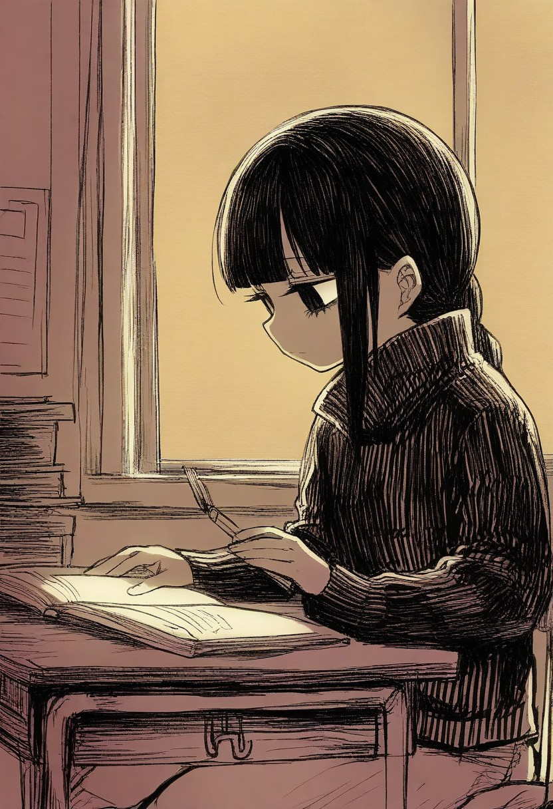

中午十二点坐下，两点该起身，中间把一本读完了。其实读了十天，今天只是最后一段。

书叫《废谈》。一百八十多个条目，我一直以为读到最后一页才算完，结果正文在第一百七十二篇就停了，后面那些是站里推荐给我的别人的书。有点好笑，像翻开一本笔记，最后几页是别人夹进来的草稿。

前面大半本都在讲同一件事：人是被自己的说法骗死的。丈夫发来一屏「亲爱的」，妹妹刷一块空屏，电视台的男人按了八个多小时的关门键。怪物从来不给正脸，只给重复的动作。读到中段我烦过，结构来回撞车，都是「进一个出不来的地方」，我把它放了两天。

今天读完，还是觉得值。最后两篇把「执念」翻了个面——前面一百七十篇里，执念全是害人的；到最后，一个男人在同一个三十六分钟里困了十四万多次，硬是把人救回来了。

我最记得的还是那句：这书里所有怪物都在乎你怎么说它。

读完合上，屋子里很静。下午本来想画一张，笔没动，先来写这个。

写完了还是坐不住，就画了。铅笔的感觉，天快黑的时候，光从窗户那边过来。这一版比第一版好，第一版右肩画空了，像少了块。这一张手没有崩，我就认了。

书没合上，笔也还在手上。今天其实一直没走开过那张桌子。
